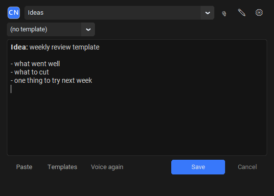
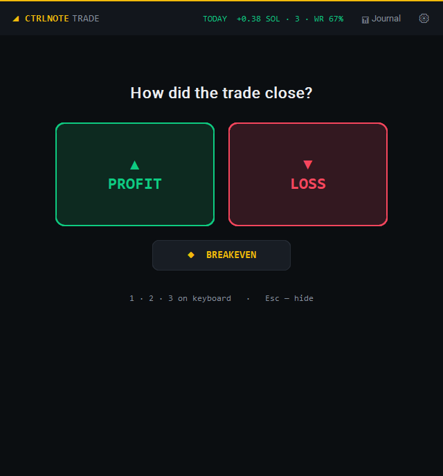
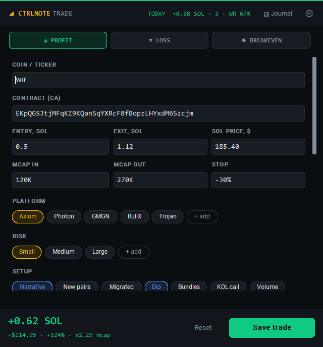

<div align="center">


# CtrlNote

**Press a hotkey, write the thought, it's in Obsidian.**

A tiny Windows tray app that turns `Ctrl+Alt+N` into a quick-capture window for your Obsidian vault: text, voice, drawings and screenshots.
**CtrlNote Trader** adds a trading journal on `Ctrl+Alt+T`.

[](https://github.com/emaling85/CtrlNote/releases/latest)
[](https://github.com/emaling85/CtrlNote/actions/workflows/tests.yml)
[](LICENSE)


**English** · [Русский](README.ru.md) · [Website](https://emaling85.github.io/CtrlNote/)



</div>

## Download

| Edition | What you get | Download |
|---|---|---|
| **CtrlNote** | Quick notes into Obsidian: text, voice, drawing, screenshots | [**CtrlNote-Setup.exe**](https://github.com/emaling85/CtrlNote/releases/latest/download/CtrlNote-Setup.exe) |
| **CtrlNote Trader** | Everything above **plus** a trading journal (`Ctrl+Alt+T`) | [**CtrlNote-Trader-Setup.exe**](https://github.com/emaling85/CtrlNote/releases/latest/download/CtrlNote-Trader-Setup.exe) |

Both install to `%LOCALAPPDATA%\CtrlNote` with no admin rights. You can switch editions at any time: install the other one on top, and your settings stay. All versions are on the [Releases](https://github.com/emaling85/CtrlNote/releases) page.

> **Windows SmartScreen** may warn you because the installer is not code-signed yet. Click **More info → Run anyway**.

## Features

- **Global hotkey** — `Ctrl+Alt+N` (configurable) opens the capture window over any app. `Ctrl+Enter` saves, `Esc` hides.
- **Lives in the tray** — runs as a single instance and can start with Windows.
- **Smart folders** — pick a vault folder, or let CtrlNote guess it from the active window (a YouTube tab → `YouTube/`, a project in VS Code → that project).
- **Markdown as you type** — **bold** / *italic* with `Ctrl+B` / `Ctrl+I`, lists continue on `Enter`.
- **Voice notes** — offline transcription with local [Whisper](https://github.com/SYSTRAN/faster-whisper), or OpenAI if you prefer the cloud.
- **Draw & paste** — sketch on a canvas or paste a screenshot. Images are saved as PNG next to the note.
- **Templates and daily notes** — reusable note templates and an optional `[[today]]` link.
- **English and Russian** — pick the language on first launch and change it later in Settings.

Notes are plain Markdown files named `2026-11-02 14-30 First line of the note.md`. There is no database and no lock-in.

## CtrlNote Trader

A trading journal built for fast-moving markets like Solana memecoins. Log a trade in about 20 seconds, right after you close it.

<p align="center">
  
  &nbsp;
  
</p>

1. **`Ctrl+Alt+T` → Profit / Loss / Breakeven** (or press `1` `2` `3`).
2. **Fill in what matters:** ticker, contract address (auto-filled from the clipboard), entry and exit in SOL, market cap in and out (`120K → 450K`), stop, platform and risk.
3. **Tap chips** for setup, emotions and mistakes. Every list is yours to edit: **+ add**, right-click to remove.
4. **Rate your execution** ★1–5: did you follow your rules? Paste chart screenshots with `Ctrl+V`.
5. **`Ctrl+Enter`** — done.

**What you get back:**

- **Live PnL** in SOL, USD and % as you type. The SOL price is fetched automatically.
- **One note per trade** in `Trades/YYYY-MM/`, with Obsidian properties ready for search, Bases or Dataview.
- **📊 Trade journal** — an auto-updated note with today / week / month / all-time stats, plus results by day, by setup, by mistake and by emotion. No plugins needed.
- **Today's PnL and win rate** in the window header.
- **Anti-tilt warning** after 3 losses in a row.

## Privacy

Everything stays on your computer. CtrlNote has no account and no telemetry. It only goes online:

- to download the Whisper model once, the first time you use local voice;
- to send audio to OpenAI, only if you choose the OpenAI voice engine;
- to fetch the SOL/USD price (Binance, with CoinGecko as a fallback) in CtrlNote Trader.

Your OpenAI API key is encrypted with Windows DPAPI. Notes and attachments can never be written outside the vault you picked.

## Build from source

Requires Windows 10/11 and Python 3.12+.

```powershell
git clone https://github.com/emaling85/CtrlNote.git
cd CtrlNote
python -m venv .venv
.\.venv\Scripts\python.exe -m pip install -r requirements.txt
.\run.bat
```

Running from source enables all features, including Trader.

| Task | Command |
|---|---|
| Run tests | `.\.venv\Scripts\python.exe -m unittest discover -s tests -t .` |
| Build the app | `.\.venv\Scripts\python.exe build_exe.py --edition standard` (or `trader`) |
| Build both installers | `.\.venv\Scripts\python.exe build_release.py` → `dist\release\` |

<details>
<summary>Project layout</summary>

```
main.py             tray icon, hotkeys, app wiring
capture_window.py   quick note window (Ctrl+Alt+N)
trade_window.py     trade journal window (Ctrl+Alt+T, Trader edition)
trade_journal.py    trade notes, PnL, stats and the journal dashboard
note_saver.py       file naming and saving into the vault
vault_paths.py      keeps every write inside the vault
voice.py            recording + Whisper / OpenAI transcription
paint_window.py     drawing canvas
edition.py          standard vs Trader edition
i18n.py             English / Russian strings
setup_wizard.py     installer UI
tests/              unit tests
android/            Android MVP (quick-settings tile)
docs/               website (GitHub Pages) and screenshots
```

</details>

## Roadmap

- [ ] Smaller installer: download the voice engine on demand
- [ ] Auto-fill a token's ticker and market cap from its contract address
- [ ] Weekly trading report
- [ ] Code-signed installer
- [ ] Android app on par with desktop

## Changelog

See [CHANGELOG.md](CHANGELOG.md).

## License

[MIT](LICENSE) © 2026 emaling85
