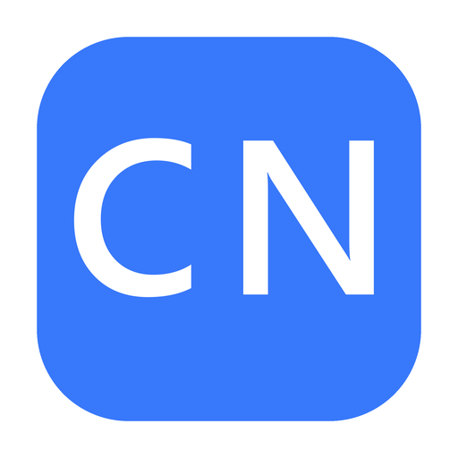
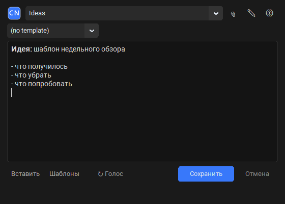
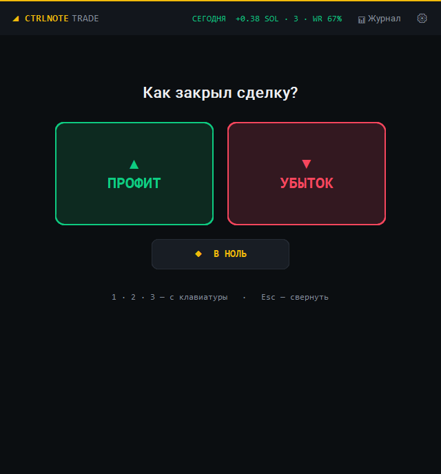
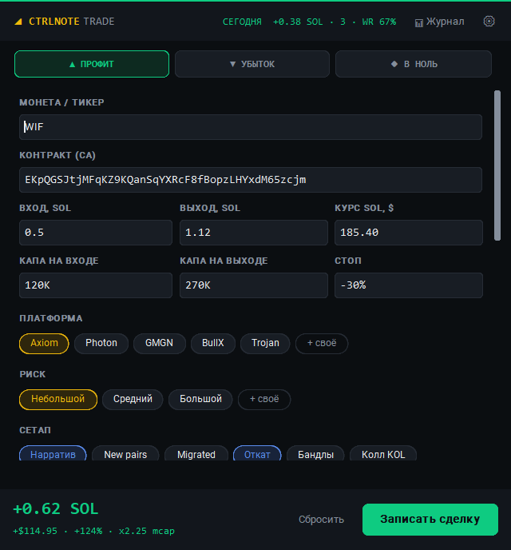

<div align="center">



# CtrlNote

**Нажал хоткей, записал мысль, она уже в Obsidian.**

Маленькое приложение в трее Windows: `Ctrl+Alt+N` открывает окно быстрой заметки прямо в твой vault Obsidian. Можно писать текст, наговаривать голосом, рисовать и вставлять скриншоты.
**CtrlNote Trader** добавляет дневник трейдера на `Ctrl+Alt+T`.

[](https://github.com/emaling85/CtrlNote/releases/latest)
[](https://github.com/emaling85/CtrlNote/actions/workflows/tests.yml)
[](LICENSE)


[English](README.md) · **Русский** · [Сайт](https://emaling85.github.io/CtrlNote/)



</div>

## Скачать

| Версия | Что внутри | Скачать |
|---|---|---|
| **CtrlNote** | Быстрые заметки в Obsidian: текст, голос, рисунок, скриншоты | [**CtrlNote-Setup.exe**](https://github.com/emaling85/CtrlNote/releases/latest/download/CtrlNote-Setup.exe) |
| **CtrlNote Trader** | Всё то же **плюс** дневник трейдера (`Ctrl+Alt+T`) | [**CtrlNote-Trader-Setup.exe**](https://github.com/emaling85/CtrlNote/releases/latest/download/CtrlNote-Trader-Setup.exe) |

Обе версии ставятся в `%LOCALAPPDATA%\CtrlNote` без прав администратора. Перейти с одной версии на другую можно в любой момент: просто поставь другую поверх, настройки сохранятся. Все версии лежат на странице [Releases](https://github.com/emaling85/CtrlNote/releases).

> **Windows SmartScreen** может предупредить при запуске, потому что установщик пока не подписан. Нажми **Подробнее → Выполнить в любом случае**.

## Возможности

- **Глобальная горячая клавиша.** `Ctrl+Alt+N` (её можно поменять) открывает окно поверх любой программы. `Ctrl+Enter` сохраняет, `Esc` прячет.
- **Живёт в трее.** Запускается в одном экземпляре, может стартовать вместе с Windows.
- **Умные папки.** Папку в vault можно выбрать вручную, а можно доверить CtrlNote: он угадает её по активному окну (вкладка YouTube → `YouTube/`, проект в VS Code → папка проекта).
- **Markdown на лету.** **Жирный** и *курсив* через `Ctrl+B` / `Ctrl+I`, списки продолжаются по `Enter`.
- **Голосовые заметки.** Офлайн-распознавание через локальный [Whisper](https://github.com/SYSTRAN/faster-whisper) или через OpenAI, если удобнее облако.
- **Рисунки и скриншоты.** Можно нарисовать на холсте или вставить скрин. Картинки сохраняются в PNG рядом с заметкой.
- **Шаблоны и daily notes.** Свои шаблоны заметок и ссылка `[[сегодня]]` по желанию.
- **Английский и русский.** Язык выбирается при первом запуске, потом его можно поменять в настройках.

Заметки — это обычные Markdown-файлы вида `2026-11-02 14-30 Первая строка заметки.md`. Никакой базы данных и никакой привязки к программе.

## CtrlNote Trader

Дневник трейдера для быстрых рынков вроде мемкоинов на Solana. Записать сделку можно секунд за 20, сразу после закрытия.

<p align="center">
  
  &nbsp;
  
</p>

1. **`Ctrl+Alt+T` → Профит / Убыток / В ноль** (или клавиши `1` `2` `3`).
2. **Заполняешь главное:** тикер, контракт (подставляется из буфера обмена), вход и выход в SOL, капу на входе и выходе (`120K → 450K`), стоп, платформу и риск.
3. **Выбираешь чипы** сетапа, эмоций и ошибок. Все списки настраиваются под себя: **+ своё** добавляет вариант, правый клик убирает.
4. **Оцениваешь исполнение** ★1–5: торговал ли по своим правилам. Скрины графика вставляются через `Ctrl+V`.
5. **`Ctrl+Enter`** — и готово.

**Что получаешь взамен:**

- **PnL на лету** в SOL, $ и % прямо во время ввода. Курс SOL подтягивается сам.
- **Отдельная заметка на каждую сделку** в `Сделки/ГГГГ-ММ/` со свойствами Obsidian, удобными для поиска, Bases или Dataview.
- **📊 Журнал сделок.** Заметка обновляется сама и показывает итоги за сегодня, неделю, месяц и всё время, а ещё разбивку по дням, сетапам, ошибкам и эмоциям. Плагины не нужны.
- **PnL и винрейт за сегодня** в шапке окна.
- **Анти-тильт:** после 3 убытков подряд окно предложит сделать паузу.

## Приватность

Все данные остаются на твоём компьютере. Нет ни аккаунта, ни телеметрии. В интернет CtrlNote ходит только в трёх случаях:

- чтобы один раз скачать модель Whisper при первом использовании локального голоса;
- чтобы отправить аудио в OpenAI, если ты сам выбрал движок OpenAI;
- чтобы узнать курс SOL/USD (Binance, запасной вариант — CoinGecko) в CtrlNote Trader.

Ключ OpenAI шифруется средствами Windows (DPAPI). Заметки и вложения никогда не записываются за пределы выбранного vault.

## Сборка из исходников

Нужны Windows 10/11 и Python 3.12+.

```powershell
git clone https://github.com/emaling85/CtrlNote.git
cd CtrlNote
python -m venv .venv
.\.venv\Scripts\python.exe -m pip install -r requirements.txt
.\run.bat
```

При запуске из исходников включены все функции, в том числе Trader.

| Задача | Команда |
|---|---|
| Тесты | `.\.venv\Scripts\python.exe -m unittest discover -s tests -t .` |
| Собрать приложение | `.\.venv\Scripts\python.exe build_exe.py --edition standard` (или `trader`) |
| Собрать оба установщика | `.\.venv\Scripts\python.exe build_release.py` → `dist\release\` |

## Планы

- [ ] Лёгкий установщик: голосовой движок докачивается по требованию
- [ ] Автозаполнение тикера и капы по адресу контракта
- [ ] Недельный отчёт по сделкам
- [ ] Подписанный установщик
- [ ] Android-версия на уровне десктопа

## История изменений

[CHANGELOG.md](CHANGELOG.md) (на английском).

## Лицензия

[MIT](LICENSE) © 2026 emaling85
